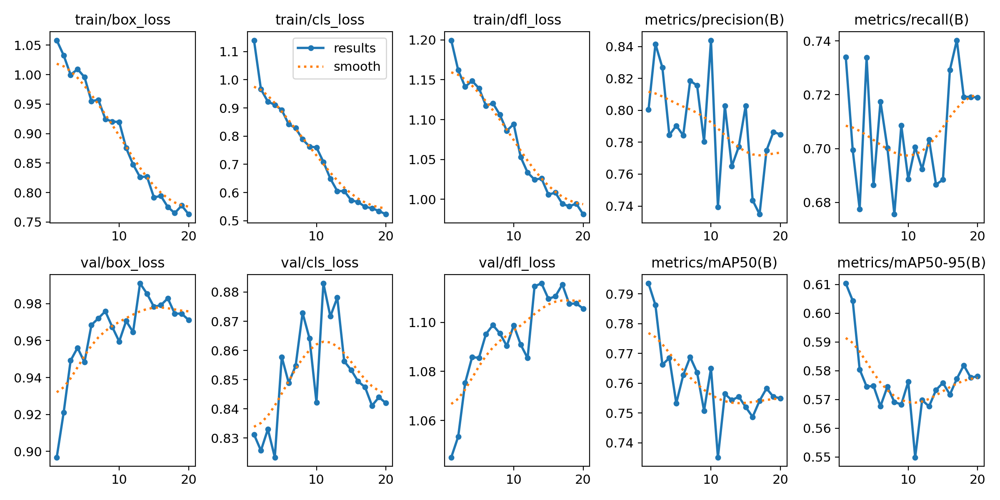

# Human & Animal Detection with YOLOv8

A lab project that finds **humans** and **animals** in photos and shows which box is which: a blue box for a human and an orange box with the name for an animal. For every photo it also prints a short summary such as `human x1, dog x1`.

The model is a pretrained **YOLOv8s** that was fine-tuned in Google Colab (T4 GPU) on a labeled subset of the COCO 2017 dataset.

Author: Md Tanzid Mondol

## Classes

The model reports 11 classes: `human` and 10 animals.

| Class | COCO id |
| --- | --- |
| human (COCO name: `person`) | 0 |
| bird | 14 |
| cat | 15 |
| dog | 16 |
| horse | 17 |
| sheep | 18 |
| cow | 19 |
| elephant | 20 |
| bear | 21 |
| zebra | 22 |
| giraffe | 23 |

The model file still holds the full COCO list of 80 class names, but only these 11 were labeled for training and only these 11 are shown.

## How it was built

1. **Data:** COCO 2017 `val2017` (5,000 photos) and its annotation file. The labels of `person` and the 10 animals were converted to YOLO format (`class x_center y_center width height`, all values between 0 and 1).
2. **Photo selection:** every photo that contains one of the 10 animals, up to 600 photos that contain only humans, and 100 background photos (no human and no animal). 80% of the photos are used for training and 20% for validation.
3. **Training:** fine-tuning of `yolov8s.pt` for 20 epochs, image size 640, batch size 16, on a Colab T4 GPU (about 9 minutes).
4. **Why the 80-class list was kept:** a first version changed the class list to 11 classes. That makes the class-recognition layers of the model start again from zero, and with so few photos the model mixed up dogs, cows and humans. Keeping the 80-class list keeps everything the pretrained model already knows.
5. **Detecting:** humans and animals are searched in two separate passes, so the box of an animal can never delete the box of a human that overlaps it (for example a man hugging a dog).

## Results

Validation photos (20% of the selected photos), best epoch:

| Precision | Recall | mAP50 | mAP50-95 |
| --- | --- | --- | --- |
| 0.80 | 0.73 | 0.79 | 0.61 |

The pretrained model already knew these classes, so the validation mAP50 stayed between 0.74 and 0.79 during the 20 epochs. The best epoch was saved automatically as `model/best_human_animal_v2.pt`.

## Files

| Path | What it is |
| --- | --- |
| `Human_Animal_Detection_v2.ipynb` | The whole process as a Colab notebook |
| `model/best_human_animal_v2.pt` | The trained model (about 22 MB) |
| `results/results.png` | Training curves |
| `results/results.csv` | The numbers of every epoch |
| `results/args.yaml` | The training settings |

## How to use

Open the notebook in Colab with the badge above, choose a T4 GPU (Runtime > Change runtime type), then:

- **Train it yourself:** run Cell 1 to Cell 6. The trained model is saved in your Google Drive.
- **Only test photos:** run Cell 7 (loads the model and the helper functions), then Cell 8 (upload photos and see the boxes). Cell 9 and Cell 10 are optional extra tests.

To use the model from this repository instead of your own Drive, download `model/best_human_animal_v2.pt`, upload it to Colab and set `MODEL_PATH` in Cell 7 to its path, for example `"/content/best_human_animal_v2.pt"`.

## Limits

- Only 10 kinds of animals are known (the COCO animals): bird, cat, dog, horse, sheep, cow, elephant, bear, zebra and giraffe. Other animals (goat, buffalo, deer, monkey and so on) can get a wrong name or be missed.
- Very small, blurry or hidden objects can be missed. Lower `CONF` in Cell 8 to find more objects.

## Credits and licenses

- Model and training code: [Ultralytics YOLOv8](https://github.com/ultralytics/ultralytics) (AGPL-3.0). The weights in this repository are fine-tuned from `yolov8s.pt`, so treat them as AGPL-3.0 too.
- Data: [COCO 2017](https://cocodataset.org) (annotations: CC BY 4.0; photos: Flickr terms). The photos are not part of this repository, the notebook downloads them.
